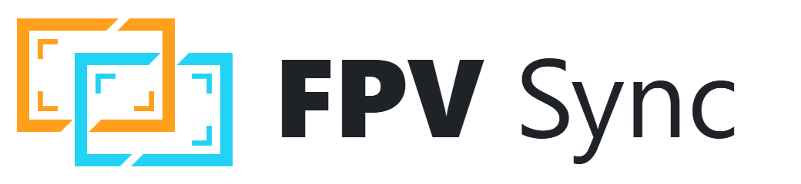
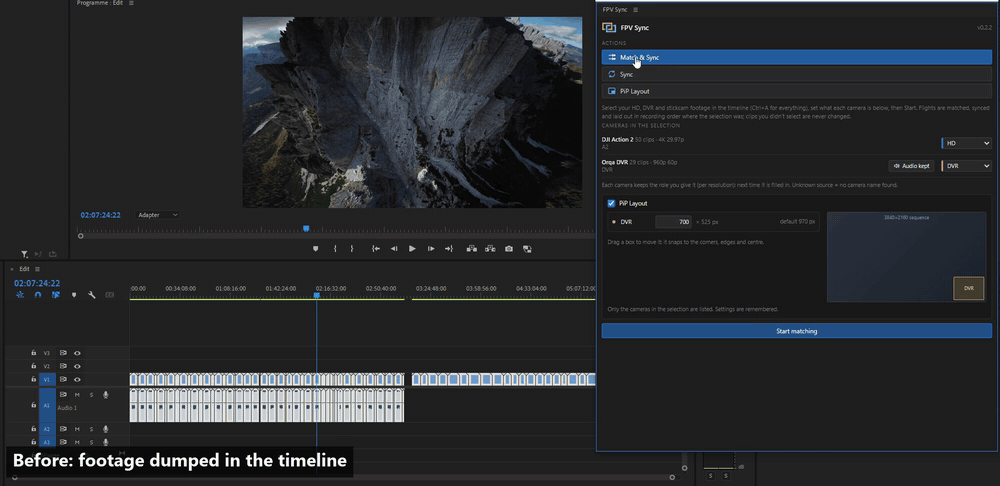
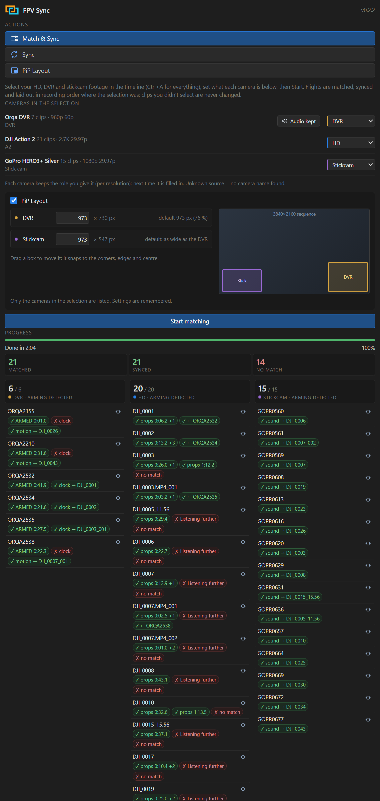
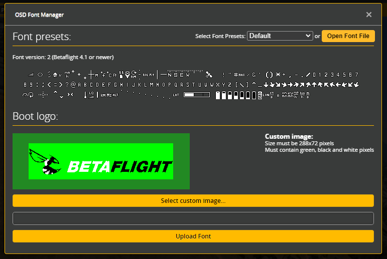
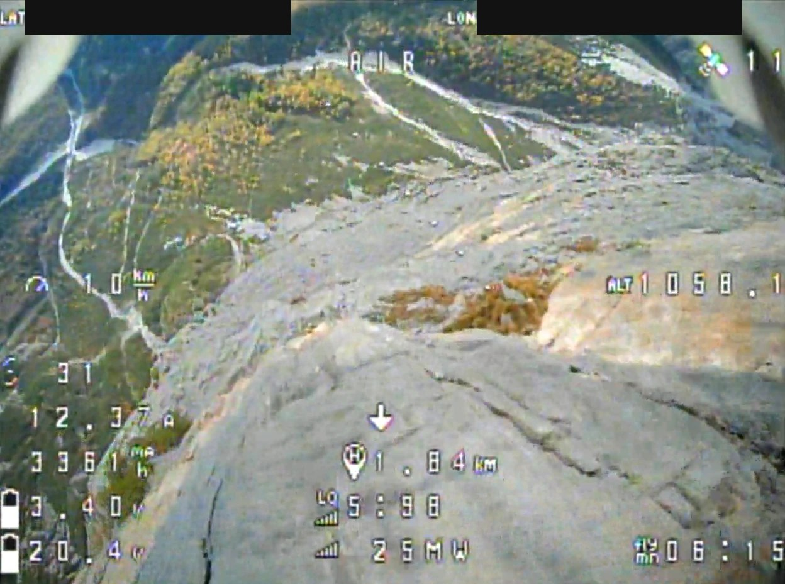
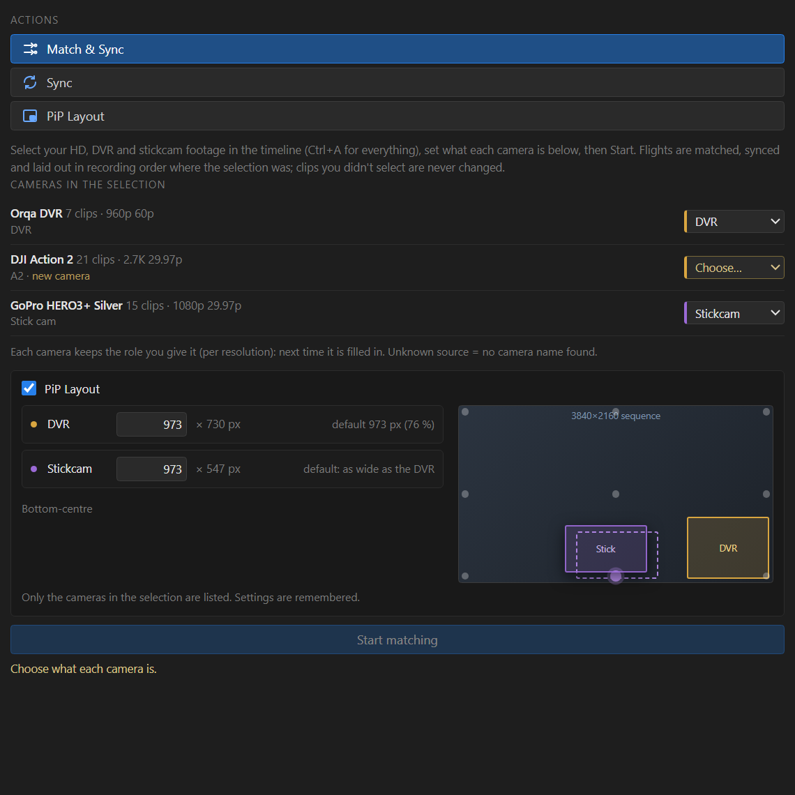
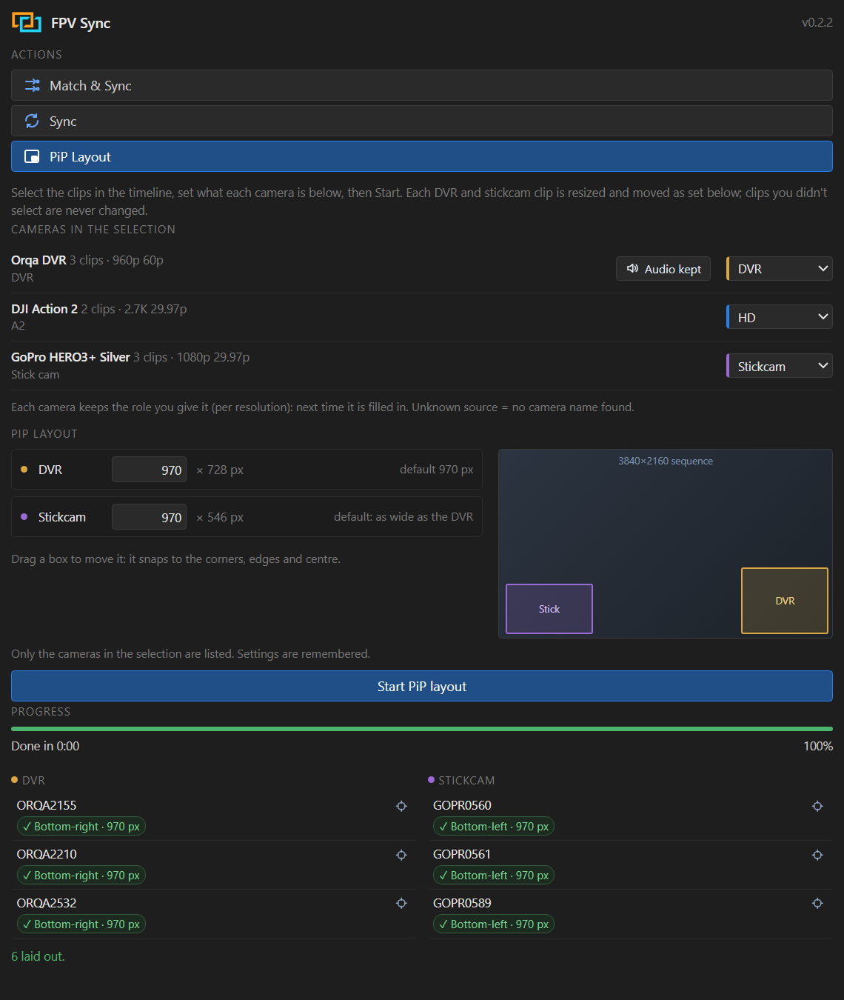

  <picture>
    <source media="(prefers-color-scheme: dark)" srcset="logo-dark.png">
    
  </picture>

<h3 align="center">Syncs all your FPV footage in one click</h3>

A Premiere Pro panel that lines up your **HD camera** footage, your **stickcam** (a camera filming your hands on the radio) and your **analog FPV DVR** recordings, then lays out the picture-in-picture for you. Drop a whole trip in the timeline at once: it works out which clips belong to which flight and syncs them to the frame.

## What it syncs

Everything is lined up against your **HD footage**, so you need at least one HD camera. The stickcam and the DVR are optional.

| Camera | Examples | Needs |
|---|---|---|
| **HD camera** (the reference) | DJI Action 2, GoPro, any camera on the quad | **Sound**, to hear the props spin up |
| **Stickcam** | Any camera filming your hands on the radio | **Sound** |
| **Analog DVR** | Any analog goggles, NTSC or PAL (tested on Orqa, Fatshark HDO2 and Skyzone) | Betaflight's **ARMED** message in the **stock OSD font**, preset *Default* (see [OSD font](#osd-font)). Digital systems (DJI, Walksnail, HDZero) aren't supported yet. |

## How it lines them up

| Camera | Synced to the frame by | Paired with the right HD clip by |
|---|---|---|
| **HD camera** | it's the reference everything else is lined up to | — |
| **Stickcam** | the **sound**: it slides the stickcam's soundtrack over the HD clip's until they line up, like Shazam (talk, clap or snap your fingers before takeoff) | the same sound match, plus the **clock** once it has proven reliable |
| **Analog DVR** | the frame where **ARMED** appears, matched to the moment the **props spin up** in the HD clip's sound (within a frame or two) | the cameras' **clocks**, the **motion** in both videos, the file numbers, and the **goggles' mic** if yours records sound |

**Clocks are only trusted once they prove themselves.** A clock can be years off or in the wrong time zone, that's fine as long as it keeps counting: the panel checks that the gap between two cameras' clocks stays the same from flight to flight. A clock that resets every time the camera powers on (some GoPros do) never passes that check and is simply ignored.

When a flight has no ARMED (the recording started mid-flight) or its props can't be heard (wind, a loud spot), the panel falls back on the clocks and the motion in both videos, and marks the flight **check** so you can look at it.

## What you need

- **Windows 10 or 11** with **Premiere Pro 2022 or newer**
- **Python 3.10+**: <https://www.python.org/downloads/> (tick **"Add python.exe to PATH"** in the installer)
- **ffmpeg**: easiest is to open a terminal and run `winget install Gyan.FFmpeg`
- Optional: an NVIDIA graphics card makes reading 4K footage faster. Without one it still works.

Footage: see [What it syncs](#what-it-syncs). The first time a new kind of goggles shows ARMED, the panel learns how its DVR draws the OSD and remembers it.

## OSD font

The panel finds the moment you arm by reading Betaflight's **ARMED** message in the DVR picture, so your quad needs Betaflight's **stock OSD font**. In Betaflight Configurator, open **OSD → Font Manager**: the font preset should be **Default**. Custom fonts and the other presets draw the letters differently, and arming won't be detected.

  
  

Left: Betaflight Configurator → OSD → Font Manager, preset <b>Default</b>. Right: the stock font as it looks in the DVR recording.

## Install

1. **[Download the latest release](https://github.com/platy4/fpv-sync/releases/latest)**: under *Assets*, click **FPV-Sync-v….zip**. Unzip it anywhere.
2. Install Python and ffmpeg if you don't have them (see above).
3. Double-click **`install.bat`**. It:
   - copies the panel into Premiere's extensions folder;
   - lets Premiere load it (it isn't signed by Adobe, so this turns on the per-user "allow unsigned panels" setting);
   - finds Python and installs `numpy` if it's missing;
   - checks for ffmpeg.

   Read what it prints: anything marked **[!!]** tells you what's missing.
4. Restart Premiere Pro. In the **menu bar at the top of Premiere**, open **Window → Extensions → FPV Sync**. You can dock the panel next to your other panels like any Premiere panel.

**Updating:** download the newest release ZIP and run `install.bat` again. The analysis cache and your settings are kept, so footage it has already read stays fast.
**Removing:** run `uninstall.bat`.

## Use

Open the panel from Premiere's **top menu bar: Window → Extensions → FPV Sync**.

1. **Pick an action** at the top: **Match & Sync**, **Sync** or **PiP Layout**. The picked one turns blue, and its instructions show underneath.
2. **Select the clips** in the timeline (Ctrl+A for everything).
3. **Say what each camera is.** The panel lists the cameras in your selection, read from the files themselves (for example *Orqa DVR*, *DJI Action 2*, *GoPro HERO5 Session*), and you set each one to **HD**, **Stickcam**, **DVR** or **None**. It remembers your choice for that camera, so next time it's already filled in. The list follows your selection as you change it.
   DVR cameras also get an **Audio kept / Audio removed** button. Keep it if your goggles record sound through a mic: that sound then also helps match the flights. Set it to removed if your goggles record silence: the DVR sound is taken out of the timeline and never listened to.
4. Click **Start**.

### Match & Sync

Put your HD, stickcam and DVR clips in a sequence (their order and placement don't matter), select them and Start. Each stickcam clip is lined up with its HD clip by sound, each DVR is matched to its flight and synced, and everything is laid out in recording order, 30 s apart, right where your selection was. Footage without a match stays in its place in time, so DVR-only or HD-only clips are easy to find.

Clips you didn't select (other cameras, B-roll) are never changed. If the synced flights need more room, the clips after them are pushed later.

### Sync

For flights you've already paired by hand: drop each stickcam or DVR clip roughly over its HD footage, select them and Start. Each clip is synced to the HD footage it overlaps. Only the selected flights are touched.

### PiP Layout

Resizes the selected stickcam and DVR clips and moves them to their spot. Drag the stickcam or DVR box in the preview: it snaps to the corners, the middle of each edge, or the centre. Sizes are in pixels: the DVR defaults to 970 px wide whatever its resolution, the stickcam to the same width as the DVR.

Match & Sync and Sync have a **PiP Layout** tickbox that does the same right after syncing. The settings are shared and remembered.

### While it runs

The progress bar shows the percentage and the time so far. Below it, every file is listed in its column (one per kind of camera) with each step as it happens: **ARMED** found, **props** heard, matched by **clock** or **motion**, lined up by **sound**, and so on. Green means it worked, red means that step didn't. The counters on top show how many were matched and synced, and how many have no match.

**Click a file** to jump the playhead to it in the timeline. The other way round works too: select one clip in the timeline and its file is highlighted in the list.

**Skip** a file that's wasting time (the ⏭ button on its row), at any point while the analysis runs: whatever it was doing on that file stops, and the file is left in recording order. Changed your mind? Click undo and it's processed again.

Your selection is locked in when you press Start, so you can click around the timeline while it runs.

**Stop** on the progress line: the first click stops reading new footage and lines up what's already analysed. A second click cancels everything, and nothing in the sequence changes.

The **first run on a trip** has to read the footage: expect a few minutes for a day of flying on a hard drive. After that the analysis is cached and re-runs take seconds.

## Tips for the stickcam

The stickcam is lined up by sound, so it helps if both cameras hear the same thing just before takeoff:
- Start both cameras, then **say something or clap 2–3 times with uneven gaps**, next to the quad, within about 30 s.
- **Say something different each pack** ("pack 4, day 1"). If you always say exactly the same thing, a clip can match another pack's just as well.
- Steady sounds (wind, a constant motor whine) and music with a regular beat don't help.

## Troubleshooting

- **FPV Sync isn't under Window → Extensions** (Premiere's top menu bar): run `install.bat` again and restart Premiere.
- **"python" or "ffmpeg" errors:** install them (see [What you need](#what-you-need)), run `install.bat` again, and restart the PC so the new PATH is picked up.
- **A camera shows as "Unknown source":** its files have no camera name in them, as with stabilised exports. Just set its role like any other.
- **No ARMED found on any DVR clip:** check that the ARMED message is on in your Betaflight OSD and that you fly the **stock OSD font** (preset **Default**, see [OSD font](#osd-font)): custom fonts aren't recognised.
- **A flight is off or unmatched:** very loud places (race events, wind) can hide the prop sound. Those flights stay unmatched or get a **check** mark; sync them by hand or with **Sync**.
- **Something else:** `%APPDATA%\Adobe\CEP\extensions\fpvsync\panel_log.txt` shows what the panel asked Premiere to do, and `timing_log.jsonl` next to it shows what each run did.

Windows only (it hasn't been tried on macOS).
